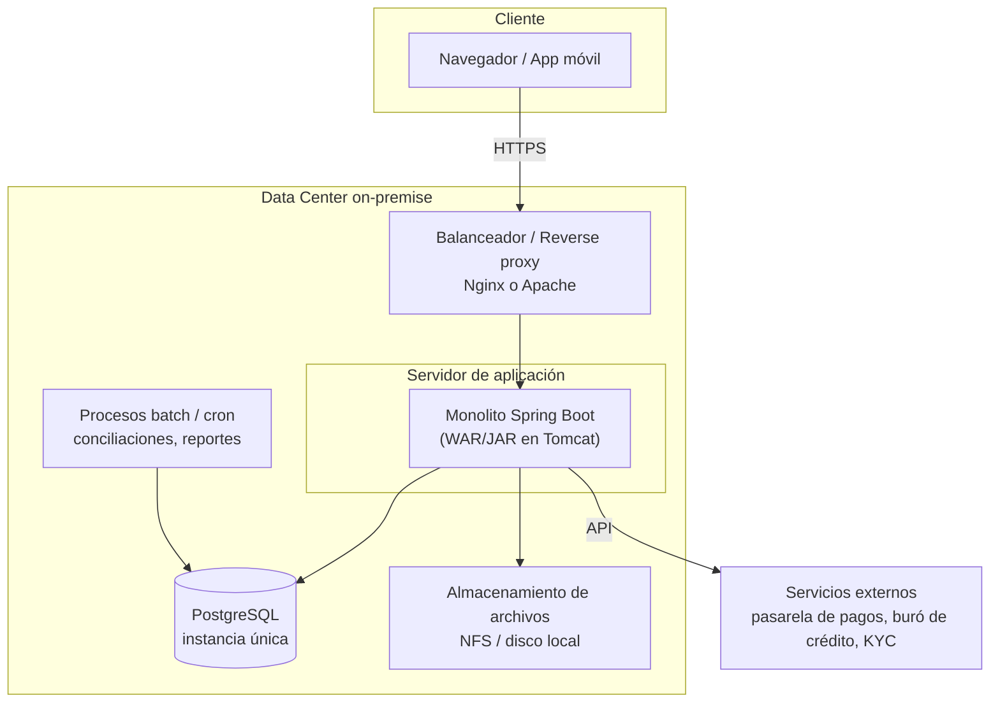
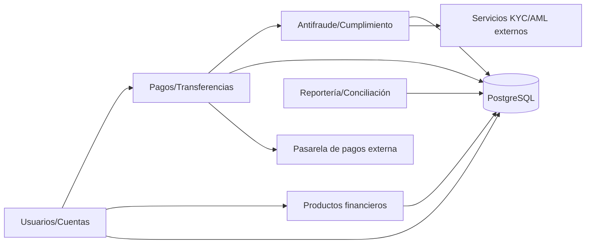

# Fase 1 — Evaluación del Sistema Existente

**Proyecto:** Migración de aplicación monolítica a Cloud (AWS)
**Fase:** 1 — Evaluación del Sistema Existente
**Autor:** Lewis Jesus Reinoso Palomino
**Fecha:** 09/Oct/2026

---

## 1. Propósito y alcance

Este documento evalúa la arquitectura y las funcionalidades actuales de la
aplicación monolítica on-premise de una empresa fintech, con el fin de
sentar la base para su migración a AWS (Fases 2 a 4).

> **Nota sobre supuestos.** El repositorio base contiene únicamente esqueletos
> de código, sin la aplicación real. Por tanto, el sistema aquí descrito se
> construye sobre **supuestos razonables** de una fintech típica, acordados
> previamente: monolito **Java / Spring Boot** con base de datos
> **PostgreSQL**. Cada supuesto relevante se marca como _[Supuesto]_.

---

## 2. Visión general de la arquitectura actual

El sistema es una **aplicación monolítica de 3 capas** desplegada on-premise:

**Características clave del estado actual** _[Supuesto]_:

- Despliegue **vertical**: una sola unidad desplegable (JAR/WAR) que contiene
  todos los módulos de negocio.
- **Escalado vertical** (más CPU/RAM al servidor) por falta de diseño para
  escalado horizontal.
- Base de datos **PostgreSQL en instancia única**, sin réplica de lectura ni
  alta disponibilidad automática.
- Infraestructura administrada manualmente (sin IaC), con despliegues
  programados en ventanas de mantenimiento.

---

## 3. Componentes principales

| Componente | Tecnología _[Supuesto]_ | Rol |
|---|---|---|
| Capa de presentación | Spring MVC / Thymeleaf o SPA servida por el monolito | Interfaz web para clientes y back-office |
| Capa de aplicación | **Java 11 + Spring Boot** (monolito) | Lógica de negocio, seguridad, orquestación |
| Capa de datos | **PostgreSQL** (instancia única) | Persistencia transaccional (cuentas, pagos, usuarios) |
| Reverse proxy / balanceo | Nginx o Apache HTTPD | Terminación TLS y enrutamiento HTTP |
| Almacenamiento de archivos | NFS / disco local | Documentos, comprobantes, adjuntos |
| Procesos batch | Spring Batch / cron | Conciliación, reportes regulatorios, notificaciones |
| Integraciones externas | APIs REST/SOAP | Pasarela de pagos, buró de crédito, KYC/AML |

---

## 4. Funcionalidades críticas (dominio fintech)

| Módulo funcional | Descripción | Criticidad |
|---|---|---|
| Gestión de usuarios y cuentas | Alta, autenticación, perfiles, saldos | Alta |
| Pagos y transferencias | Procesamiento de transacciones, idempotencia | **Crítica** |
| Gestión de productos financieros | Créditos, inversiones, estados de cuenta | Alta |
| Antifraude / cumplimiento | Reglas AML, límites, trazabilidad | **Crítica** |
| Reportería y conciliación | Reportes regulatorios y financieros (batch) | Alta |
| Notificaciones | Correo / SMS a clientes | Media |

Todas las funcionalidades comparten **la misma base de código y la misma base
de datos**, lo que crea fuerte acoplamiento entre módulos.

---

## 5. Interacción entre módulos y dependencias

**Dependencias relevantes:**

- **Base de datos única como punto central**: todos los módulos dependen de
  PostgreSQL. Es el principal **single point of failure (SPOF)**.
- **Acoplamiento en tiempo de compilación**: un cambio en un módulo obliga a
  recompilar y redesplegar **todo** el monolito.
- **Dependencias externas síncronas**: pagos y antifraude dependen de APIs de
  terceros; su latencia o caída afecta directamente al usuario.
- **Estado en el servidor**: archivos y, posiblemente, sesiones almacenados
  localmente, lo que dificulta el escalado horizontal.

---

## 6. Limitaciones técnicas y operacionales

| # | Limitación | Impacto | Relevancia para la migración |
|---|---|---|---|
| 1 | **Escalado solo vertical** | No absorbe picos de demanda; costo alto | Motiva escalado horizontal / autoscaling en AWS |
| 2 | **Base de datos sin HA** (instancia única) | SPOF; riesgo de pérdida de servicio | Motiva Amazon RDS Multi-AZ + réplicas de lectura |
| 3 | **Despliegue monolítico** | Releases lentos y riesgosos; sin despliegue independiente | Motiva contenedores / microservicios por fases |
| 4 | **Infra manual, sin IaC** | Errores humanos, baja reproducibilidad | Motiva IaC (Terraform/CloudFormation) + CI/CD |
| 5 | **Estado local (archivos/sesión)** | Impide escalar en horizontal | Motiva Amazon S3 + sesiones externalizadas |
| 6 | **Observabilidad limitada** | Diagnóstico lento ante incidentes | Motiva CloudWatch / tracing centralizado |
| 7 | **Recuperación ante desastres débil** | RTO/RPO altos; backups manuales | Motiva backups automatizados y multi-AZ |
| 8 | **Mantenimiento con downtime** | Ventanas de indisponibilidad | Motiva despliegues blue/green o rolling |

---

## 7. Hallazgos y conclusiones

1. El sistema **cumple su función** pero está limitado por su naturaleza
   monolítica y su infraestructura manual on-premise.
2. Los principales riesgos son el **SPOF de la base de datos**, la
   **imposibilidad de escalar horizontalmente** y la **ausencia de
   automatización** (IaC/CI-CD).
3. Las funcionalidades **críticas** (pagos y antifraude) exigen alta
   disponibilidad y trazabilidad, requisitos que la arquitectura actual
   satisface de forma frágil.
4. Estos hallazgos **justifican la migración a AWS** y orientan el diseño de la
   Fase 2 hacia: alta disponibilidad gestionada (RDS Multi-AZ), escalado
   elástico (contenedores/autoscaling), almacenamiento desacoplado (S3),
   automatización (IaC + CI/CD) y observabilidad centralizada (CloudWatch).

---

## 8. Entregable

Este documento constituye el **entregable de la Fase 1**: evaluación detallada
del sistema actual, sus componentes, dependencias y limitaciones, como insumo
para el diseño de la arquitectura cloud (Fase 2).

> _Los elementos marcados como [Supuesto] deben validarse/ajustarse con la
> información real del sistema cuando esté disponible._
