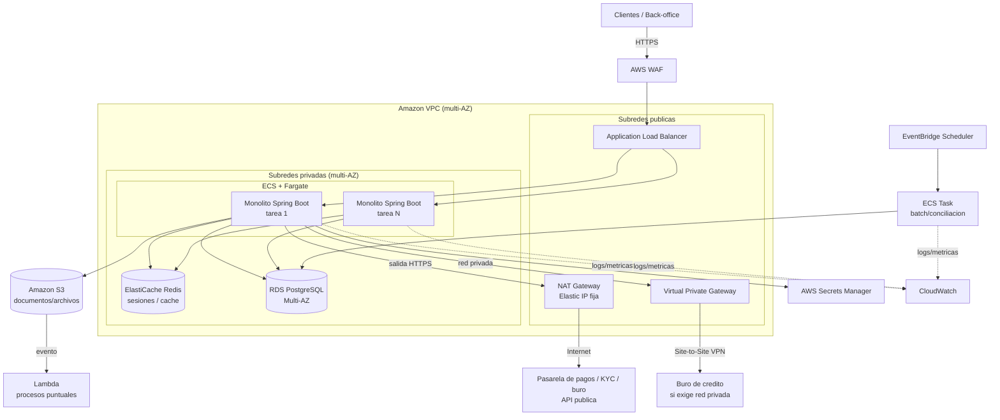

# Fase 2 — Diseño de la Arquitectura en Cloud (AWS)

**Proyecto:** Migración de aplicación monolítica a Cloud (AWS)
**Fase:** 2 — Diseño de la Arquitectura en Cloud
**Autor:** _(completar)_
**Fecha:** _(completar)_

---

## 1. Propósito y alcance

Diseñar una arquitectura en AWS que **replique toda la funcionalidad** del
monolito on-premise evaluado en la Fase 1, resolviendo sus limitaciones
técnicas y operacionales, con foco en **alta disponibilidad, escalabilidad,
seguridad y automatización**.

**Estrategia de migración adoptada:** *rehosting con contenedores* (lift &
shift moderado). El monolito **Java / Spring Boot** se empaqueta en una imagen
Docker y se ejecuta en infraestructura gestionada, **sin reescribir la
aplicación**. La descomposición en microservicios se plantea como una **fase
de modernización futura** (patrón *strangler fig*), no como parte de esta
migración.

> **Nota.** La aplicación sigue siendo un **monolito**; contenerizarla no la
> convierte en microservicios. Lo que se gana es infraestructura moderna
> (HA, escalado horizontal, autorrecuperación), no una arquitectura de
> microservicios.

---

## 2. Arquitectura propuesta (vista general)

---

## 3. Servicios AWS seleccionados y justificación

| Capa / necesidad | Servicio AWS | Justificación |
|---|---|---|
| **Cómputo** | **Amazon ECS + Fargate** | Ejecuta el contenedor del monolito sin administrar servidores; escalado horizontal automático y autorrecuperación de tareas |
| **Base de datos** | **Amazon RDS for PostgreSQL (Multi-AZ)** | Mismo motor PostgreSQL (migración directa) con failover automático, backups y parches gestionados. Elimina el SPOF de la BD |
| **Balanceo / entrada** | **Application Load Balancer (ALB)** | Balanceo HTTP/HTTPS entre tareas, health checks y terminación TLS. Adecuado para una app web monolítica |
| **Seguridad perimetral** | **AWS WAF** | Protección de capa 7 (OWASP Top 10, SQLi, XSS) antes del ALB |
| **Caché / sesiones** | **Amazon ElastiCache (Redis)** | Externaliza sesiones y caché para permitir escalado horizontal sin estado local |
| **Almacenamiento de archivos** | **Amazon S3** | Almacenamiento durable y desacoplado para documentos/adjuntos; reemplaza el disco/NFS local |
| **Red** | **Amazon VPC** (subredes públicas/privadas, multi-AZ) | Aislamiento de red; solo el ALB y las salidas controladas quedan expuestos |
| **Salida a internet** | **NAT Gateway** (Elastic IP fija) | Permite salida HTTPS controlada hacia APIs de terceros; la IP fija habilita el *whitelisting* del proveedor |
| **Conexión privada a terceros** | **Site-to-Site VPN** (opcional) | Para burós/sistemas que exigen conectividad privada sin pasar por internet |
| **Secretos** | **AWS Secrets Manager** | Credenciales de BD y API keys de terceros fuera del código, con rotación |
| **Batch / cron** | **EventBridge Scheduler + ECS Tasks** | Reemplaza los cron on-premise (conciliación, reportes) con tareas programadas |
| **Eventos puntuales** | **AWS Lambda** | Procesamiento event-driven (p. ej. al llegar un archivo a S3); no ejecuta el monolito |
| **Observabilidad** | **Amazon CloudWatch** | Logs, métricas y alarmas centralizadas |
| **IaC (Fase 4)** | **Terraform / CloudFormation** | Infraestructura reproducible y versionada |

---

## 4. Cómo se replica la funcionalidad actual

| Funcionalidad on-premise | Equivalente en AWS |
|---|---|
| Monolito Spring Boot en servidor de app | Contenedor del monolito en ECS/Fargate (varias tareas) |
| PostgreSQL instancia única | RDS PostgreSQL Multi-AZ (+ réplica de lectura si se requiere) |
| Reverse proxy (Nginx/Apache) | ALB (terminación TLS y enrutamiento) |
| Archivos en NFS / disco local | Amazon S3 |
| Sesiones en memoria del servidor | ElastiCache Redis |
| Procesos batch / cron | EventBridge Scheduler + ECS Tasks |
| Integraciones externas (pagos, buró, KYC) | Salida vía NAT Gateway / Site-to-Site VPN |
| Monitoreo manual | CloudWatch (logs, métricas, alarmas) |

Toda la funcionalidad se preserva; cambia **dónde y cómo** se ejecuta, no
**qué** hace la aplicación.

---

## 5. Decisiones de diseño clave

### 5.1 Fargate en lugar de EC2 + Auto Scaling
Fargate evita administrar y parchear instancias (menos carga operativa).
*Trade-off:* costo por unidad algo mayor que EC2, a cambio de menor operación.
Si el equipo prioriza control del SO o costo, EC2 + Auto Scaling Group es la
alternativa válida.

### 5.2 Por qué NO se usa API Gateway
El sistema es **un monolito** que ya resuelve su propio enrutamiento interno
(`/pagos`, `/cuentas`, etc.). El ALB cubre completamente la entrada HTTP/HTTPS.
Añadir API Gateway delante del ALB agregaría latencia, costo y complejidad
**sin beneficio** para un monolito. API Gateway se incorporaría cuando:
- se descomponga el monolito en **microservicios** (fachada única), o
- se expongan **APIs públicas a terceros** con API keys/throttling, o
- existan backends **Lambda** expuestos como HTTP.

La Lambda de este diseño se dispara por **evento de S3**, no por HTTP, por lo
que tampoco requiere API Gateway.

### 5.3 Multi-AZ y resiliencia
VPC, ECS, RDS y ElastiCache se despliegan en **múltiples zonas de
disponibilidad**. RDS Multi-AZ ofrece failover automático; ECS reparte tareas
entre AZs. Esto reduce drásticamente el RTO/RPO frente al on-premise.

### 5.4 Conectividad a servicios externos
Salida principal por **NAT Gateway** (con Elastic IP fija para *whitelisting*).
Para proveedores que exijan red privada, **Site-to-Site VPN**. Credenciales en
Secrets Manager; security groups de **egress restringidos**; llamadas con
timeouts/reintentos (las integraciones externas son dependencias síncronas, un
riesgo identificado en la Fase 1).

---

## 6. Seguridad transversal

- **Red:** app y datos en subredes **privadas**; solo ALB y salidas
  controladas expuestos.
- **Perímetro:** WAF + Security Groups con mínimo privilegio (ingress/egress).
- **Datos en tránsito:** TLS en el ALB y hacia terceros.
- **Datos en reposo:** cifrado con **KMS** en RDS, S3, ElastiCache y backups.
- **Identidad:** roles de **IAM** por servicio (tareas ECS con permisos
  mínimos); credenciales en **Secrets Manager**.
- **Auditoría:** CloudTrail para trazabilidad de acciones en la cuenta.

---

## 7. Trazabilidad: limitación (Fase 1) → solución (Fase 2)

| # | Limitación (Fase 1) | Solución (Fase 2) |
|---|---|---|
| 1 | Escalado solo vertical | ECS/Fargate con escalado horizontal automático |
| 2 | BD sin alta disponibilidad (SPOF) | RDS PostgreSQL **Multi-AZ** |
| 3 | Despliegue monolítico y riesgoso | Contenedor + despliegues rolling/blue-green (Fase DevOps) |
| 4 | Infra manual, sin IaC | Terraform/CloudFormation + CI/CD |
| 5 | Estado local (archivos/sesión) | **S3** + **ElastiCache Redis** |
| 6 | Observabilidad limitada | **CloudWatch** (logs, métricas, alarmas) |
| 7 | Recuperación ante desastres débil | Multi-AZ + backups automatizados |
| 8 | Mantenimiento con downtime | Despliegues sin downtime (rolling/blue-green) |

---

## 8. Entregable

Este documento constituye el **entregable de la Fase 2**: diseño de la
arquitectura cloud en AWS, con diagrama, selección y justificación de
servicios, decisiones clave y trazabilidad frente a las limitaciones del
sistema actual. Sirve de base para la **Fase 3 (plan de migración)** y la
implementación de **IaC**.

> _Los elementos y supuestos deben validarse con la información real del
> sistema y los requisitos no funcionales (RTO/RPO, picos de carga, SLAs)
> cuando estén disponibles._
