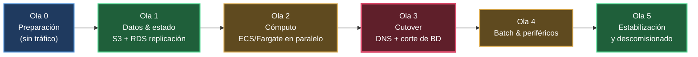
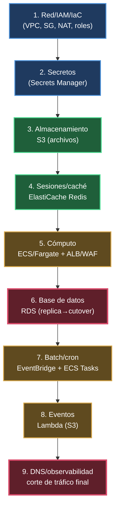

# Fase 3 — Planificación de la Migración

**Proyecto:** Migración de aplicación monolítica a Cloud (AWS)
**Fase:** 3 — Planificación de la Migración
**Autor:** Lewis Jesus Reinoso Palomino
**Fecha:** 09/Oct/2026

---

## 1. Propósito y alcance

Este documento define el **plan detallado de migración** del monolito fintech
on-premise (evaluado en la Fase 1) hacia la arquitectura AWS diseñada en la
Fase 2, con dos objetivos explícitos del reto: **minimizar el tiempo de
inactividad (downtime)** y **minimizar el riesgo**.

El plan cubre:

1. Cronograma paso a paso (por olas).
2. Riesgos identificados y su mitigación.
3. Estrategia para minimizar downtime.
4. Orden de migración de cada componente y sus dependencias.
5. Plan de rollback ante problemas.

> **Supuestos de planificación** _[Supuesto]_: se mantiene la base de la Fase 1
> (monolito **Java 11 / Spring Boot** + **PostgreSQL**) y la arquitectura
> destino de la Fase 2 (**ECS Fargate, RDS PostgreSQL Multi-AZ, ALB + WAF,
> ElastiCache Redis, S3, NAT Gateway, Secrets Manager, EventBridge + ECS Tasks,
> CloudWatch**). Se asume estrategia de **rehosting con contenedores** (lift &
> shift moderado), **sin reescribir** la aplicación.

### 1.1 Objetivos no funcionales (metas de la migración)

| Métrica | Meta propuesta _[Supuesto, validar con negocio]_ |
|---|---|
| **RTO** (tiempo de recuperación) | ≤ 15 min tras incidente mayor |
| **RPO** (pérdida de datos aceptable) | ≤ 5 min (replicación/backup continuo) |
| **Downtime de cutover** | ≤ 15 min (ventana de solo lectura breve) |
| **Umbral de rollback** | Error > 2% o p95 latencia > 1.5× baseline por 10 min |

---

## 2. Estrategia general de migración

Se adopta una **migración incremental por olas** en lugar de un "big bang",
tal como sugiere la pista de la Fase 3 ("migración incremental para reducir el
riesgo"). Cada ola es desplegable, verificable y **reversible** de forma
independiente.



**Principio rector:** el on-premise permanece **activo y como fallback** hasta
que la operación en AWS se valide por completo. Solo entonces se descomisiona.

---

## 3. Cronograma paso a paso

Duración estimada total: **~6 semanas** _[Supuesto]_. Las olas 0–2 ocurren sin
afectar producción; el downtime real se concentra en una ventana breve de la
Ola 3.

### Ola 0 — Preparación (Semana 1–2) · *sin impacto en producción*

| # | Actividad | Responsable | Salida |
|---|---|---|---|
| 0.1 | Provisionar VPC, subredes multi-AZ, SG, NAT, IAM vía **IaC (Terraform)** | Cloud/DevOps | Infra base reproducible |
| 0.2 | Crear RDS PostgreSQL Multi-AZ, ElastiCache, bucket S3, Secrets Manager | Cloud | Servicios destino listos |
| 0.3 | **Contenerizar** el monolito (Dockerfile) y publicar imagen en **ECR** | Dev | Imagen versionada |
| 0.4 | Pipeline **CI/CD** (build, test, push, deploy a ECS) | DevOps | Despliegue automatizado |
| 0.5 | Externalizar config: credenciales a Secrets Manager; endpoints por variables de entorno | Dev | App 12-factor |
| 0.6 | Habilitar **salida de archivos y sesiones** hacia S3/Redis (feature flag) | Dev | Estado desacoplado |
| 0.7 | Observabilidad: CloudWatch logs/métricas/alarmas + dashboards | DevOps | Monitoreo base |

### Ola 1 — Datos y estado (Semana 2–3) · *sin corte*

| # | Actividad | Salida |
|---|---|---|
| 1.1 | Migración inicial de archivos NFS/disco → **S3** (sincronización incremental) | Archivos en S3 |
| 1.2 | Configurar **replicación continua** on-prem PostgreSQL → RDS mediante **AWS DMS** (carga completa + CDC) | RDS sincronizada en near-real-time |
| 1.3 | Validar integridad: conteos de filas, checksums, pruebas de consistencia | Reporte de validación |
| 1.4 | Mantener la replicación corriendo (RDS va "al día" con on-prem) | Lag de replicación monitoreado |

### Ola 2 — Cómputo en paralelo (Semana 3–4) · *sin tráfico productivo*

| # | Actividad | Salida |
|---|---|---|
| 2.1 | Desplegar el monolito en **ECS/Fargate** apuntando a RDS (réplica) en modo **solo pruebas** | Entorno AWS funcional |
| 2.2 | Pruebas de humo, funcionales y de carga contra el entorno AWS | Evidencia de paridad |
| 2.3 | Validar integraciones externas por **NAT Gateway (EIP fija)**; solicitar *whitelisting* al proveedor | Conectividad a terceros OK |
| 2.4 | Pruebas de failover de RDS Multi-AZ y de autorrecuperación de tareas ECS | Resiliencia verificada |

### Ola 3 — Cutover (Semana 4) · **ventana de downtime controlada (≤15 min)**

Ver detalle en la sección 5 (estrategia de downtime).

### Ola 4 — Batch y periféricos (Semana 5)

| # | Actividad | Salida |
|---|---|---|
| 4.1 | Migrar cron/Spring Batch a **EventBridge Scheduler + ECS Tasks** | Batch en AWS |
| 4.2 | Conectar eventos **S3 → Lambda** para procesos puntuales | Event-driven activo |
| 4.3 | Validar conciliaciones y reportes regulatorios end-to-end | Reportes correctos |

### Ola 5 — Estabilización y descomisionado (Semana 6)

| # | Actividad | Salida |
|---|---|---|
| 5.1 | Hypercare: monitoreo intensivo 24/7 durante 5–7 días | Operación estable |
| 5.2 | Afinar autoscaling, alarmas y costos | Optimización |
| 5.3 | **Descomisionar on-premise** solo tras validación completa | Cierre de migración |
| 5.4 | Documentar lecciones aprendidas (insumo Fase 4) | Entregable Fase 4 |

---

## 4. Orden de migración de componentes y dependencias

El orden respeta las dependencias detectadas en la Fase 1 (la BD es el punto
central; el estado local bloquea el escalado horizontal). Se migra **primero lo
que no tiene estado o es fácilmente reversible**, y **de último la base de
datos transaccional** (el corte más delicado).



| Orden | Componente | Por qué en esta posición | Dependencias previas |
|---|---|---|---|
| 1 | **Red, IAM, IaC** | Base de todo; sin impacto en prod | — |
| 2 | **Secrets Manager** | Lo necesitan app y BD antes de arrancar | Red/IAM |
| 3 | **S3 (archivos)** | Sin estado transaccional; sincronizable de forma incremental y reversible | Red/IAM |
| 4 | **ElastiCache (sesiones/caché)** | Debe existir antes de levantar la app sin estado local | Red |
| 5 | **ECS/Fargate + ALB + WAF** | Capa de cómputo; se prueba en paralelo sin recibir tráfico real | S3, Redis, Secrets |
| 6 | **RDS PostgreSQL** | **Último y más crítico**: concentra el downtime del cutover | Replicación previa (DMS) |
| 7 | **Batch (EventBridge/ECS Tasks)** | Puede migrarse tras el core sin afectar transacciones online | RDS en AWS |
| 8 | **Lambda (eventos S3)** | Periférico, event-driven | S3 |
| 9 | **DNS / tráfico** | El switch final que redirige usuarios | Todo lo anterior validado |

---

## 5. Estrategia para minimizar el downtime

Objetivo: **ventana de corte ≤ 15 min**, idealmente percibida por el usuario
como una breve indisponibilidad de escrituras.

### 5.1 Técnicas aplicadas

- **Replicación previa con CDC (AWS DMS):** RDS se mantiene sincronizada con
  on-prem *antes* del corte, de modo que el día del cutover solo falte aplicar
  el delta final (segundos de datos), no toda la base.
- **Ventana de solo-lectura (read-only) breve:** en lugar de apagar todo, se
  pone la app en modo lectura para "congelar" escrituras mientras se sincroniza
  el último delta y se promueve RDS como primaria.
- **Despliegue sin downtime en cómputo:** ECS con despliegue **rolling** o
  **blue/green** vía ALB; las tareas nuevas reciben tráfico solo tras pasar
  *health checks* (resuelve la limitación #8 de la Fase 1).
- **Cambio de DNS con TTL bajo:** reducir el TTL del registro DNS a 60 s
  **48 h antes** del cutover para que el switch propague rápido.
- **Idempotencia en pagos:** las transacciones de pago ya son idempotentes
  (Fase 1), lo que permite reintentos seguros durante la transición.

### 5.2 Secuencia del cutover (Ola 3)

```mermaid
%%{init: {'theme':'dark', 'themeVariables': {'actorBkg':'#1f3a5f','actorBorder':'#4a90d9','actorTextColor':'#ffffff','signalColor':'#d9a84a','signalTextColor':'#ffffff','noteBkgColor':'#5f1f2a','noteTextColor':'#ffffff','noteBorderColor':'#d94a6a'}}}%%
sequenceDiagram
    participant U as Usuarios
    participant OP as On-premise (actual)
    participant DMS as AWS DMS (CDC)
    participant RDS as RDS (destino)
    participant ECS as ECS/Fargate (AWS)
    participant DNS as DNS

    Note over OP: T0 — Anuncio de ventana de mantenimiento
    OP->>U: Modo solo-lectura activado (escrituras en pausa)
    OP->>DMS: Flush del último delta
    DMS->>RDS: Aplica delta final (CDC)
    Note over RDS: Validación de consistencia (conteos/checksums)
    RDS->>ECS: Promover RDS como primaria; apuntar ECS a RDS
    ECS->>ECS: Health checks OK
    DNS->>U: Switch de DNS → ALB (AWS)
    Note over U,ECS: Escrituras reactivadas en AWS
    Note over OP: On-premise queda como fallback (no se apaga aún)
```

### 5.3 Momento recomendado

Ejecutar el cutover en **ventana de bajo tráfico** (p. ej. madrugada de
domingo) _[Supuesto, validar con negocio/SLA]_, con el equipo de guardia y el
plan de rollback listo.

---

## 6. Riesgos identificados y mitigación

Matriz priorizada (P = probabilidad, I = impacto, en escala Baja/Media/Alta).

| # | Riesgo | P | I | Mitigación | Plan de contingencia |
|---|---|---|---|---|---|
| R1 | **Pérdida o inconsistencia de datos** en el corte de BD | Media | **Alta** | Replicación CDC previa + validación de checksums + ventana read-only | Rollback a on-prem (sigue activo); reconciliar deltas |
| R2 | **Downtime mayor al previsto** | Media | Alta | Ensayo de cutover (*dry-run*) cronometrado; delta mínimo gracias a DMS | Abortar y reprogramar; usuarios vuelven a on-prem |
| R3 | **Fallo de integraciones externas** (pagos/KYC/buró) por IP no autorizada | Alta | Alta | NAT Gateway con **EIP fija** + *whitelisting* solicitado con antelación; probado en Ola 2 | Mantener salida por on-prem temporalmente; reintentos con backoff |
| R4 | **Diferencias de comportamiento** app on-prem vs. contenedor | Media | Media | Pruebas funcionales y de carga en Ola 2; paridad de versión Java/JVM y zona horaria | Rollback de cómputo (DNS a on-prem) |
| R5 | **Lag de replicación alto** impide corte limpio | Baja | Alta | Monitoreo del lag de DMS; esperar a lag ~0 antes de cortar | Posponer cutover hasta estabilizar |
| R6 | **Costos inesperados** (NAT, egress, Fargate) | Media | Media | Estimación previa + presupuestos y alarmas de **AWS Budgets** | Ajustar sizing/autoscaling; revisar dimensionamiento |
| R7 | **Configuración de seguridad** (SG/IAM) deja expuesto o bloquea tráfico | Media | Alta | IaC revisado por pares; mínimo privilegio; WAF; pruebas de penetración básicas | Revertir cambio de IaC (versionado) |
| R8 | **Sesiones de usuario perdidas** al escalar horizontalmente | Media | Media | Sesiones externalizadas en ElastiCache antes del cutover | Reautenticación forzada (impacto bajo) |
| R9 | **Errores en batch/conciliación** tras migrar cron | Media | Alta | Ejecutar batch en paralelo on-prem/AWS y comparar resultados antes de cortar | Volver a cron on-prem para ese proceso |
| R10 | **Resistencia/confusión de stakeholders** | Baja | Media | Comunicación del plan, ventana y rollback (pista Fase 3) | Canal de soporte reforzado en hypercare |

---

## 7. Plan de rollback

**Premisa central:** on-premise **no se apaga** hasta completar la Ola 5. Esto
convierte el rollback en una opción real y de bajo costo en casi todas las
olas.

### 7.1 Criterios de activación (abort gate)

Se activa rollback si durante o tras el cutover se cumple alguno:

- Tasa de error de la aplicación **> 2%** sostenida por 10 min.
- Latencia **p95 > 1.5×** del baseline on-prem por 10 min.
- Inconsistencia de datos detectada en validación.
- Fallo crítico de integración de **pagos** o **antifraude** (módulos críticos,
  Fase 1).

### 7.2 Rollback por componente

| Componente | Procedimiento de rollback | Tiempo estimado |
|---|---|---|
| **DNS / tráfico** | Revertir registro DNS al ALB/LB on-prem (TTL 60 s) | < 5 min |
| **Cómputo (ECS)** | Despliegue blue/green: mantener versión previa; conmutar target group | < 5 min |
| **Base de datos (RDS)** | Reactivar on-prem como primaria; **reconciliar** escrituras del lapso en AWS hacia on-prem (DMS en sentido inverso o script de replay) | 15–30 min |
| **Archivos (S3)** | On-prem sigue sirviendo archivos; S3 queda como copia | Inmediato |
| **Sesiones (Redis)** | Volver a sesiones locales; forzar reautenticación | Inmediato |
| **Batch** | Reactivar cron on-prem; desactivar EventBridge | < 10 min |
| **IaC/Red/Seguridad** | `terraform apply` de la versión previa (estado versionado) | Variable |

### 7.3 Punto de no retorno

El **único paso con rollback costoso** es la BD una vez que AWS recibe
escrituras productivas. Por eso el cutover incluye la ventana read-only y la
validación de consistencia **antes** de reactivar escrituras en AWS: hasta ese
instante, abortar es trivial (DNS de vuelta a on-prem).

### 7.4 Ensayo previo (dry-run)

Antes del cutover real se ejecuta al menos **un ensayo completo** del
procedimiento (secciones 5.2 y 7.2) en el entorno AWS de pruebas, cronometrando
cada paso y validando el rollback. Ningún cutover productivo ocurre sin un
dry-run exitoso.

---

## 8. Recursos necesarios

| Recurso | Detalle |
|---|---|
| **Equipo** | Líder de migración, Cloud/DevOps (1–2), Dev backend (1–2), DBA, QA, Seguridad, on-call |
| **Herramientas** | Terraform/CloudFormation, ECR, AWS DMS, CI/CD, CloudWatch, AWS Budgets |
| **Accesos** | Cuenta AWS con IAM adecuado, credenciales de terceros en Secrets Manager, VPN/whitelisting con proveedores |
| **Ventanas** | Una ventana de mantenimiento de bajo tráfico para la Ola 3 + disponibilidad de guardia en hypercare |

---

## 9. Comunicación a stakeholders

Siguiendo la pista de la Fase 3 ("cómo comunicar el plan"):

- **Antes:** anuncio de la ventana de mantenimiento (fecha, hora, duración
  estimada, impacto), plan de rollback y canal de soporte.
- **Durante:** actualizaciones de estado en cada hito del cutover (inicio,
  corte, validación, switch, fin).
- **Después:** confirmación de cierre, resultados de validación y periodo de
  hypercare. Insumo directo para la **Fase 4 (evaluación de la migración)**.

---

## 10. Entregable

Este documento constituye el **entregable de la Fase 3**: plan de migración
detallado con cronograma por olas, orden de componentes y dependencias,
estrategia de minimización de downtime, matriz de riesgos con mitigaciones y
plan de rollback por componente. Sirve de base para la ejecución (IaC/CI-CD) y
la **Fase 4 (evaluación de la migración y lecciones aprendidas)**.

> _Los tiempos, RTO/RPO y ventanas marcados como [Supuesto] deben validarse con
> negocio, SLAs y los requisitos no funcionales reales antes de ejecutar._
