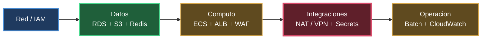
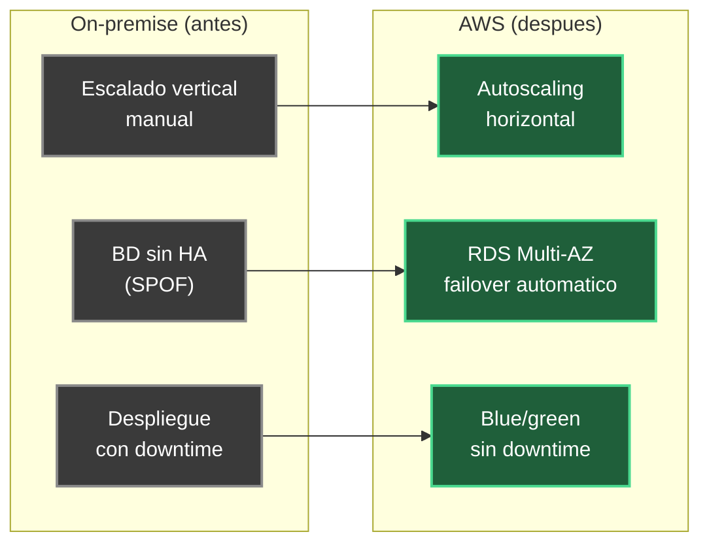

# Fase 4 — Evaluación de la Migración

**Proyecto:** Migración de aplicación monolítica a Cloud (AWS)
**Fase:** 4 — Evaluación de la Migración
**Autor:** Lewis Jesus Reinoso Palomino
**Fecha:** 09/Oct/2026

---

## 1. Propósito y alcance

Evaluar el **éxito de la migración** del monolito fintech on-premise hacia la
arquitectura AWS (diseñada en la Fase 2 y ejecutada según el plan de la Fase
3), verificando que todos los componentes migraron correctamente, que la
funcionalidad se mantiene intacta y que el rendimiento mejora o se conserva.
Además, documenta las **lecciones aprendidas** y entrega **recomendaciones**
para futuras migraciones.

> **Nota sobre el entorno.** Como el proyecto base no cuenta con un sistema
> productivo real, los resultados de validación y las métricas de rendimiento
> se expresan como **criterios de aceptación y valores de referencia
> esperados** _[Supuesto]_. En un proyecto real, estas tablas se completan con
> las mediciones obtenidas durante el *parallel run* y el *hypercare*.

---

## 2. Validación de componentes migrados

Verificación de que cada componente de la arquitectura destino quedó operativo
y correctamente configurado.

| # | Componente | Criterio de validación | Estado esperado |
|---|---|---|---|
| 1 | **VPC / Red / IAM** | Subredes multi-AZ, security groups de mínimo privilegio, roles IAM aplicados | ✅ OK |
| 2 | **RDS PostgreSQL Multi-AZ** | Instancia primaria + standby; failover probado; backups automáticos activos | ✅ OK |
| 3 | **ECS / Fargate** | Tareas del monolito en ejecución, health checks en verde, autoscaling activo | ✅ OK |
| 4 | **ALB + WAF** | Terminación TLS, reglas WAF activas, enrutamiento a tareas sano | ✅ OK |
| 5 | **ElastiCache Redis** | Sesiones externalizadas; app sin estado local | ✅ OK |
| 6 | **Amazon S3** | Archivos migrados; integridad validada (checksums); cifrado KMS | ✅ OK |
| 7 | **NAT Gateway / VPN** | Salida a terceros (pagos/KYC/buró) con IP fija en whitelist | ✅ OK |
| 8 | **Secrets Manager** | Credenciales fuera del código; rotación habilitada | ✅ OK |
| 9 | **EventBridge + ECS Tasks** | Batch/cron migrados y ejecutando según programación | ✅ OK |
| 10 | **CloudWatch** | Logs, métricas, alarmas y dashboards operativos | ✅ OK |

---

## 3. Verificación de funcionalidad (paridad)

Se valida que cada funcionalidad crítica identificada en la Fase 1 se comporta
igual (o mejor) en AWS. La prueba de paridad se ejecuta durante el *parallel
run*, comparando resultados on-premise vs. AWS.

| Funcionalidad (Fase 1) | Prueba de aceptación | Resultado esperado |
|---|---|---|
| Gestión de usuarios y cuentas | Login, consulta de perfil y saldo | Igual que on-premise |
| **Pagos y transferencias** (crítica) | Transacción de prueba + idempotencia | Igual; sin doble cargo |
| Productos financieros (créditos/inversiones) | Alta y consulta de producto | Igual |
| **Antifraude / cumplimiento** (crítica) | Reglas AML y límites aplicados | Igual; trazabilidad OK |
| Reportería y conciliación (batch) | Ejecución batch y comparación de salidas | Reportes idénticos |
| Notificaciones | Envío de correo/SMS de prueba | Entregado |
| Integraciones externas | Llamada real a pagos/KYC/buró | Respuesta correcta |

**Criterio de aceptación global:** 100% de las funcionalidades críticas con
paridad confirmada antes del cutover definitivo.

---

## 4. Comparación de rendimiento (on-premise vs. cloud)

Métricas de referencia a medir antes (baseline on-premise) y después (AWS). Los
valores objetivo son _[Supuesto]_ y deben reemplazarse con mediciones reales.

| Métrica | On-premise (baseline) | AWS (objetivo) | Mejora esperada |
|---|---|---|---|
| Latencia p95 (API) | referencia | ≤ 1× baseline | Igual o mejor |
| Throughput (TPS pico) | referencia | ≥ 1.5× baseline | Mayor por autoscaling |
| Disponibilidad mensual | ~99.5% | ≥ 99.9% | Multi-AZ |
| Tiempo de recuperación (RTO) | horas | ≤ 15 min | Failover automático |
| Pérdida de datos (RPO) | último backup | ≈ 0–5 min | Replicación continua |
| Tiempo de despliegue | ventana programada | minutos (CI/CD) | Despliegues sin downtime |
| Escalado ante picos | manual / vertical | automático / horizontal | Elasticidad |

---

## 5. Lecciones aprendidas

| Tema | Lección | Acción futura |
|---|---|---|
| **Datos** | La replicación continua (DMS/CDC) es lo que hace viable un downtime mínimo; subestimarla causa cortes largos | Iniciar la replicación con suficiente antelación y monitorear el lag |
| **Volumen de archivos** | Migrar 15+ TB por red toma más de lo previsto | Evaluar AWS Snowball desde el inicio si el ancho de banda es limitado |
| **Integraciones externas** | El *whitelisting* de IP con terceros tiene tiempos de gestión largos | Solicitar autorización de la Elastic IP con semanas de anticipación |
| **Estado de la app** | Externalizar sesiones (Redis) es prerequisito para escalar horizontal | Resolver el estado antes de contenerizar |
| **Ensayos** | El *dry-run* del cutover reveló pasos no documentados | Ensayar siempre el cutover completo antes del real |
| **Costos** | Servicios como NAT Gateway y egress generan costos no obvios | Configurar AWS Budgets y alarmas desde el día 1 |
| **Equipo** | La curva de aprendizaje de AWS impacta los tiempos | Capacitación previa y runbooks claros |

---

## 6. Recomendaciones para futuras migraciones

1. **Migrar primero, modernizar después.** El rehosting con contenedores
   reduce el riesgo; la descomposición a microservicios (patrón *strangler
   fig*) se aborda como fase posterior.
2. **Infraestructura como código desde el inicio.** Todo recurso vía
   Terraform/CloudFormation para reproducibilidad y rollback por versión.
3. **Automatizar la observabilidad.** Dashboards, alarmas y trazabilidad
   configurados antes del cutover, no después.
4. **Mantener el origen como fallback.** No descomisionar on-premise hasta
   completar el *hypercare*.
5. **Validar con datos reales en paralelo.** El *parallel run* es la mejor
   garantía de paridad funcional y de rendimiento.
6. **Optimización continua de costos.** Revisar sizing de RDS/Fargate, uso de
   Savings Plans y políticas de ciclo de vida en S3 tras estabilizar.
7. **Seguridad por diseño.** Mínimo privilegio (IAM/SG), cifrado KMS en reposo
   y TLS en tránsito, secretos gestionados, auditoría con CloudTrail.

---

## 7. Conclusión

La migración se considera **exitosa** cuando: (a) todos los componentes están
operativos y validados (sección 2), (b) la funcionalidad crítica tiene paridad
confirmada (sección 3) y (c) las métricas de rendimiento igualan o superan el
baseline on-premise (sección 4). La arquitectura resultante resuelve las ocho
limitaciones identificadas en la Fase 1, aportando alta disponibilidad,
escalado elástico, automatización y observabilidad centralizada.

---

## 8. Entregable

Este documento constituye el **entregable de la Fase 4**: evaluación de la
migración con validación de componentes, verificación de funcionalidad,
comparación de rendimiento, lecciones aprendidas y recomendaciones. Con él se
cierra el ciclo de las cuatro fases del reto.

> _Los resultados y métricas marcados como [Supuesto] deben completarse con las
> mediciones reales obtenidas durante el parallel run y el hypercare._
